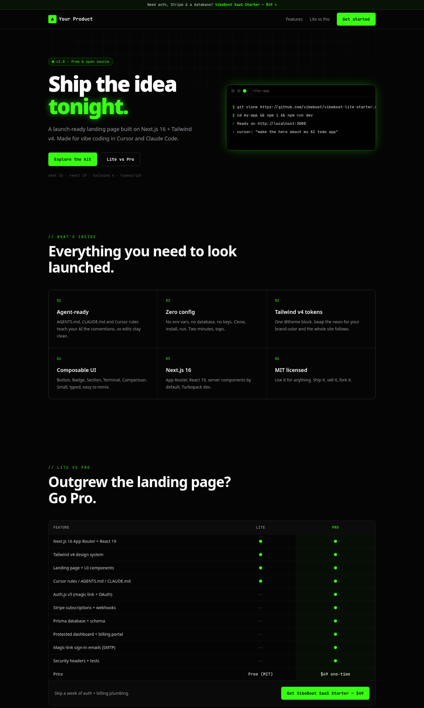

<div align="center">

# ▲ VibeBoot Lite Starter

**A free Next.js 16 + Tailwind v4 landing-page starter, set up for coding with Cursor and Claude Code.**

**[Live preview → lite.vibeboot.dev](https://lite.vibeboot.dev)** · MIT licensed

Clone, install, run. No env vars, no database, no keys.

[](https://vercel.com/new/clone?repository-url=https%3A%2F%2Fgithub.com%2Fvibeboot%2Fvibeboot-lite-starter&project-name=my-vibeboot-app&repository-name=my-vibeboot-app) [](https://app.netlify.com/start/deploy?repository=https%3A%2F%2Fgithub.com%2Fvibeboot%2Fvibeboot-lite-starter)

[](https://lite.vibeboot.dev)

</div>

## Quickstart

```bash
git clone https://github.com/vibeboot/vibeboot-lite-starter.git my-app
cd my-app
npm install
npm run dev     # http://localhost:3000
```

Then open it in Cursor or Claude Code and say: *"Rewrite the hero for my product."*
`AGENTS.md`, `CLAUDE.md` and `.cursor/rules/` already teach the agent the conventions.

## What's inside

- **Next.js 16** App Router, React 19, TypeScript strict
- **Tailwind v4** with brand tokens in a single `@theme` block (`src/app/globals.css`)
- **Landing page**: hero, animated terminal, feature grid, comparison table
- **Components**: `Button`, `Badge`, `Section`, `Nav`, `Footer`, `Terminal`, `Comparison`
- **Agent-ready**: `AGENTS.md`, `CLAUDE.md`, `.cursor/rules/project.mdc` (AGENTS.md also carries the block `next dev` adds, which points agents at the Next.js docs bundled in `node_modules`)
- **One config file**: `src/lib/site.ts` holds all copy and links

```
src/
├─ app/         layout.tsx · page.tsx · globals.css
├─ components/  ui.tsx · nav · footer · terminal · comparison · pro-banner
└─ lib/         site.ts
```

## Scripts

| Command | What it does |
| --- | --- |
| `npm run dev` | Dev server (Turbopack) |
| `npm run build` | Production build |
| `npm run lint` | ESLint |
| `npm run typecheck` | `tsc --noEmit` |
| `npm run check` | All of the above, in one go |

## Lite vs Pro

Lite gets you a landing page that looks launched. When you need real users and real money, the
**[VibeBoot SaaS Starter](https://vibeboot.dev/templates/saas-starter)** has those parts wired up.

| | Lite (this repo) | SaaS Starter |
| --- | :---: | :---: |
| Next.js 16 + React 19 + Tailwind v4 | ✅ | ✅ |
| Landing page + UI components | ✅ | ✅ |
| Cursor rules / AGENTS.md / CLAUDE.md | ✅ | ✅ |
| Auth.js v5 (magic link + OAuth) | — | ✅ |
| Stripe subscriptions + webhooks | — | ✅ |
| Prisma database + schema | — | ✅ |
| Protected dashboard + billing portal | — | ✅ |
| Magic-link sign-in emails (SMTP) | — | ✅ |
| Security headers + tests | — | ✅ |
| Price | **Free (MIT)** | **$49 one-time** |

👉 **[Get the SaaS Starter — $49](https://vibeboot.gumroad.com/l/saas-starter)**

## Removing the upgrade banner

Set `NEXT_PUBLIC_HIDE_PRO_BANNER=1`, or delete `<ProBanner />` from `src/app/layout.tsx`. It's your app.

## Deploy

- **One click**: use the Deploy buttons at the top. Vercel or Netlify copies this repo to your GitHub account and deploys it. No env vars needed (optional: `NEXT_PUBLIC_HIDE_PRO_BANNER=1`).
- **Vercel or Netlify**: import the repo with the default settings (`npm run build`).
- **Any static host** (Cloudflare Pages, GitHub Pages, S3): run `STATIC_EXPORT=1 npm run build` and upload the `out/` folder. The live preview is built and hosted this way, on Cloudflare Pages.

## License

[MIT](LICENSE) © VibeBoot
